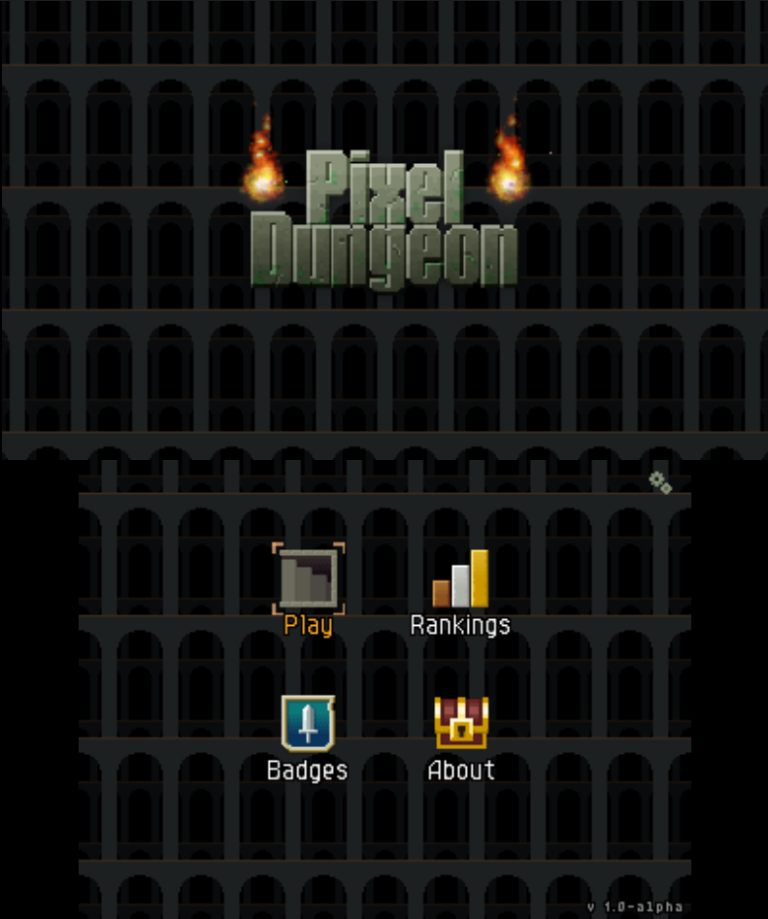
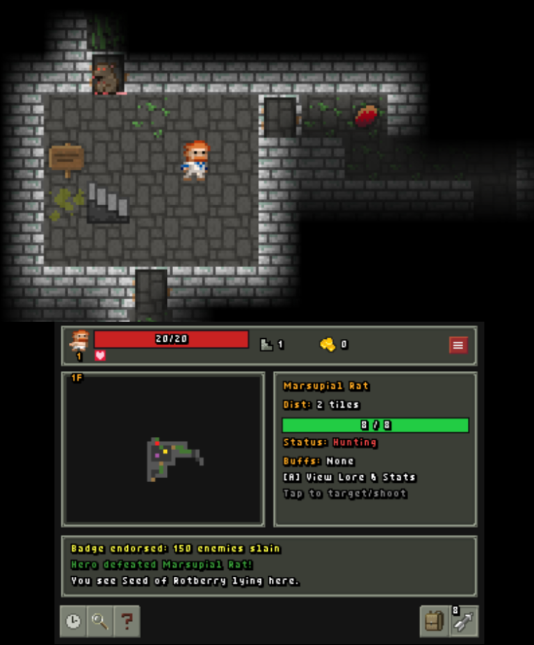
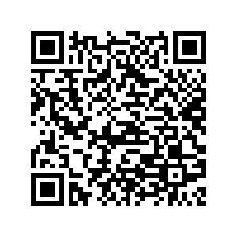

# Pixel Dungeon for Nintendo 3DS

A port of the classic open-source roguelike **Pixel Dungeon** by Watabou, built for the Nintendo 3DS family of systems.

DISCLAIMER: AI was used in creating this port - mainly in translating Java function to C++. Use this app at your own risk and do not post this code anywhere that AI-generated code is not allowed.

---

## Screenshots

  
  
  

---

## ALPHA RELEASE

The current release is in an Alpha state. There will likely be bugs and gameplay disparities. Please help resolve these quickly by reporting them in the Issues tab.

---

## Installation
### Installing via `.cia`
1. Download `PixelDungeon.cia` from the latest release assets.
2. Copy `PixelDungeon.cia` to your SD card (e.g., `sdmc:/cias/`).
3. Launch **FBI** on your 3DS.
4. Navigate to `SD` $\to$ `cias` $\to$ `PixelDungeon.cia` and select **Install and delete CIA**.
5. Return to the HOME Menu to unwrap the game icon.

### Running via `.3dsx` (Homebrew Launcher)
1. Download `PixelDungeon.3dsx` and `PixelDungeon.smdh`.
2. Place both files in `sdmc:/3ds/PixelDungeon/`.
3. Launch via the **Homebrew Launcher**.

---

##Original Github Readme

Traditional roguelike game with pixel-art graphics and simple interface.

Pixel Dungeon on GooglePlay: https://play.google.com/store/apps/details?id=com.watabou.pixeldungeon

Official web-site: http://pixeldungeon.watabou.ru/

Developer's blog: http://pixeldungeon.tumblr.com/
